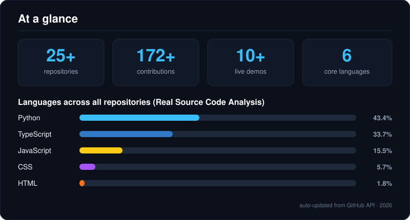

<!-- Header Section: Typing Animation & Profile Badges -->
<p align="center">
  <a href="https://git.io/typing-svg">
    
  </a>
</p>

<p align="center">
  <a href="https://hailemichael-portfolio-psi.vercel.app/" target="_blank">
    
  </a>
  <a href="https://drive.google.com/file/d/1O4EJ0Q-Nw_7WvPVtyXmyzULZQNzE1VGL/view" target="_blank">
    
  </a>
  <a href="https://www.linkedin.com/in/hailemichael-tesfaye-2b7114401/" target="_blank">
    
  </a>
  
</p>

---

<!-- At a glance Section -->
<p align="center">
  
</p>

---

### 🕹️ Dynamic Contribution Snake Game

<p align="center">
  <picture>
    <source media="(prefers-color-scheme: dark)" srcset="https://raw.githubusercontent.com/hailemichaeltesfsye-hue/hailemichaeltesfsye-hue/output/github-contribution-grid-snake-dark.svg?sanitize=true">
    <source media="(prefers-color-scheme: light)" srcset="https://raw.githubusercontent.com/hailemichaeltesfsye-hue/hailemichaeltesfsye-hue/output/github-contribution-grid-snake.svg?sanitize=true">
    
  </picture>
</p>

---

### 🛠️ Tech Stack

#### 💻 Programming Languages
<p align="left">
  <a href="#"></a>
</p>

#### ⚙️ Backend Engineering & APIs
<p align="left">
  <a href="#"></a>
</p>

#### 🎨 Frontend & Mobile Development
<p align="left">
  <a href="#"></a>
</p>

#### 🗄️ Databases & Data Stores
<p align="left">
  <a href="#"></a>
</p>

#### 🤖 AI, Machine Learning & Agentic Systems
<p align="left">
  <a href="#"></a>
</p>
<p align="left">
  
  
  
  
  
  
</p>

#### 🛠️ Developer Tools & Infrastructure
<p align="left">
  <a href="#"></a>
</p>

---

### 🐍 Animated Developer Terminal

<p align="center">
  
</p>

---

### 🚀 Featured Projects

---

#### 🏙️ NEXUS: The Living City
**Autonomous AI Digital Twin & Multi-Agent Metropolitan OS for Addis Ababa (ኔክሰስ አዲስ አበባ)**  
*Meta Global AI Hackathon ($150K Grand Challenge Submission)*  
Autonomous municipal digital twin orchestrating 11 cognitive city-governance agents, real-time satellite telemetry, zero-shot computer vision hazard segmentation, and dual Amharic/English voice dispatch.  
**Technology:** `Meta Llama 3.3 70B` · `Modal H100 GPU` · `Meta SAM Vision` · `Llama-Guard 3` · `TypeScript` · `Three.js` · `Vercel`  
<p align="left">
  <a href="https://nexus-the-living-city.vercel.app" target="_blank">
    
  </a>
  <a href="https://github.com/hailemichaeltesfsye-hue/-nexus-the-living-city" target="_blank">
    
  </a>
</p>

---

#### 🛡️ NetsuGuard AI
**Autonomous Multi-Agent Security & LLM Guardrail Intelligence**  
Enterprise-grade agentic defense platform that intercepts prompt injections, enforces safety boundary guardrails, and coordinates real-time self-correcting security agents.  
**Technology:** `Python` · `LangGraph` · `ChromaDB` · `FastAPI` · `Groq` · `Tailwind CSS`  
<p align="left">
  <a href="https://github.com/hailemichaeltesfsye-hue/netsaguard-ai" target="_blank">
    
  </a>
</p>

---

#### 🩺 Healthcare Diagnostic Loop v2
**Autonomous P2P Multi-Agent Healthcare Diagnostic Platform**  
End-to-end multi-agent clinical diagnostic workflow featuring differential diagnosis validation, medical knowledge graph verification, and interactive real-time telemetry.  
**Technology:** `Python` · `LangChain` · `FastAPI` · `ChromaDB` · `Medical Graph UI`  
<p align="left">
  <a href="https://github.com/hailemichaeltesfsye-hue/healthcare-diagnostic-loop-v2" target="_blank">
    
  </a>
</p>

---

#### 👥 SOC Agent Workforce
**Autonomous Multi-Agent Cybersecurity & Threat Hunting Operations**  
Specialized squad of autonomous agents monitoring anomalous network telemetry, triaging CVE alerts, and automatically formulating incident response playbooks.  
**Technology:** `Python` · `LangGraph` · `Model Context Protocol (MCP)` · `REST APIs`  
<p align="left">
  <a href="https://github.com/hailemichaeltesfsye-hue/soc-agent-workforce" target="_blank">
    
  </a>
</p>

---

#### 🛍️ Amazon Full-Stack Architecture
**Full-Scale Commercial E-Commerce Platform**  
End-to-end e-commerce engine with user auth, product catalogs, shopping basket persistence, Stripe checkout integration, and cloud-hosted microservices.  
**Technology:** `React.js` · `Node.js` · `Express` · `Firebase Firestore` · `Stripe API`  
<p align="left">
  <a href="https://github.com/hailemichaeltesfsye-hue/amazon-clone-frontend" target="_blank">
    
  </a>
  <a href="https://github.com/hailemichaeltesfsye-hue/amazon-clone-backend" target="_blank">
    
  </a>
</p>

---

### 📊 GitHub Activity & Statistics

<p align="center">
  
  
</p>

<p align="center">
  
</p>

---

### 🌟 About Me

```text
🚀 Fluent across the stack. The best systems emerge at the intersection of disciplines.
🎯 Building Multi-Agent AI Workflows, Scalable Web Applications & Cloud Architectures
📍 Kombolcha, Ethiopia
🎓 BSc in Software Engineering · Wollo University (KIOT)
🏆 Meta Global AI Developer Hackathon ($150K Challenge)
```

---

### 📬 Get In Touch

<p align="center">
  <a href="mailto:hailemichaeltesfsye@gmail.com">
    
  </a>
  <a href="https://www.linkedin.com/in/hailemichael-tesfaye-2b7114401/" target="_blank">
    
  </a>
  <a href="https://hailemichael-portfolio-psi.vercel.app/" target="_blank">
    
  </a>
  <a href="https://github.com/hailemichaeltesfsye-hue" target="_blank">
    
  </a>
</p>
